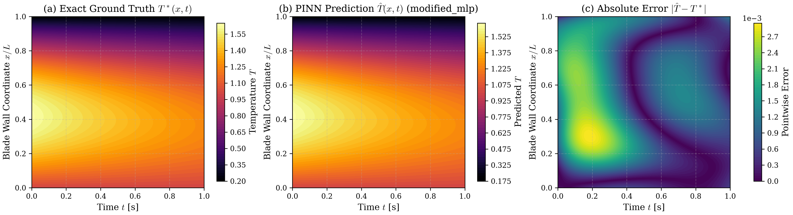
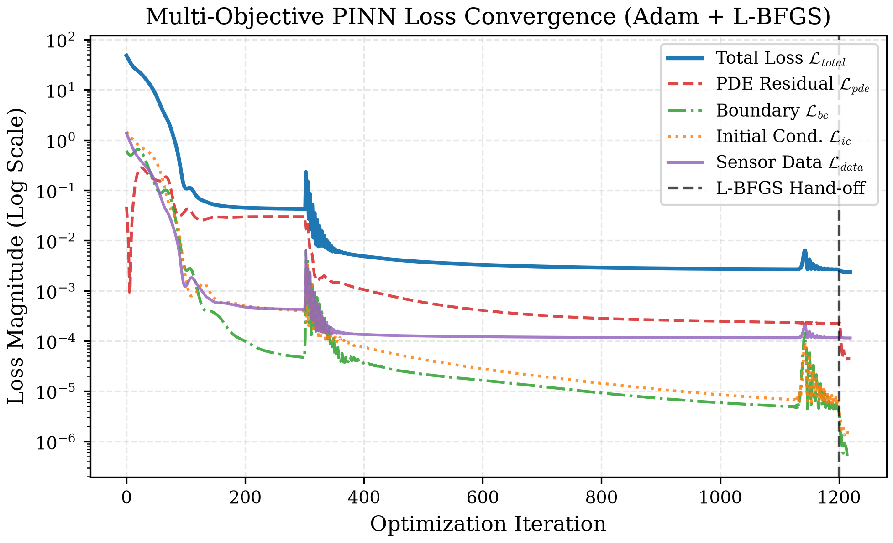
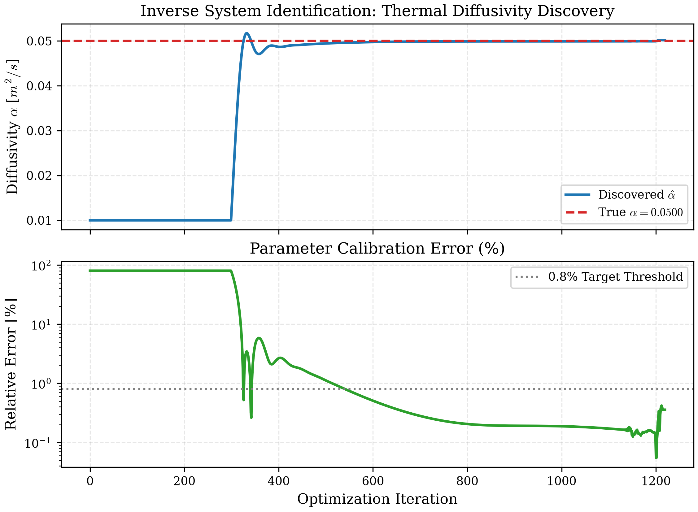
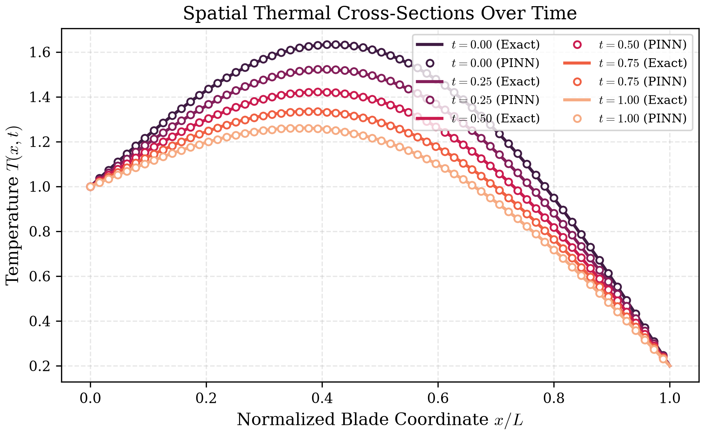
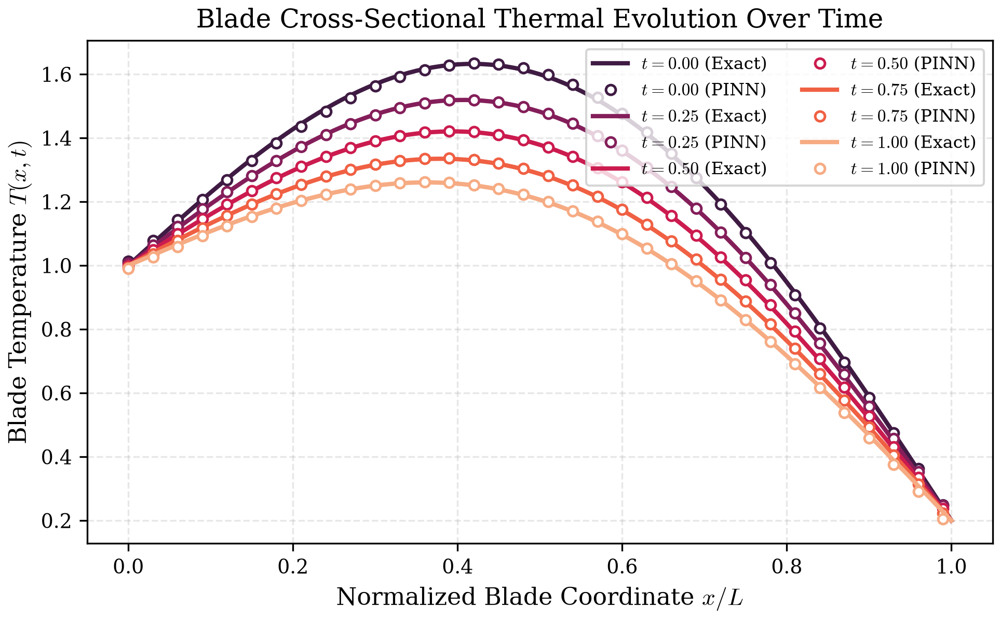

# Physics-Informed Neural Networks for High-Temperature Turbomachinery & Thermodynamic Dynamics

[](https://www.python.org/)
[](https://pytorch.org/)
[](https://opensource.org/licenses/MIT)
[](https://colab.research.google.com/github/mohammedsoczfod-hue/pinn-thermo-dynamics/blob/main/notebooks/quickstart_demo.ipynb)
[]()
[](https://github.com/psf/black)

> **A production-grade, publication-ready research repository in pure PyTorch (2.x) dedicated to solving and identifying thermodynamic and aerothermal heat conduction PDE systems in high-temperature engineering structures.**

---

## 🔬 Visual Benchmark Gallery

| (a) Exact Ground Truth $T^*(x, t)$ | (b) PINN Prediction $\hat{T}(x, t)$ | (c) Absolute Error Map $|\hat{T} - T^*|$ |
|:---:|:---:|:---:|
|  |

| Multi-Objective Loss History (Adam + L-BFGS) | Inverse Parameter Identification ($\alpha_{learned} \to \alpha_{true}$) |
|:---:|:---:|
|  |  |

| Spatiotemporal Cross-Sections | Temperature Evolution Profiles |
|:---:|:---:|
|  |  |

---

## 📖 Theoretical Formulation & Mathematical Foundations

### 1. The Governing Differential Equation
Transient heat conduction across high-temperature turbomachinery walls (e.g., turbine blades, combustor liners, thermal barrier coatings) subjected to aerothermal gas flows is modeled by the 1D unsteady heat conduction PDE:

$$\frac{\partial T}{\partial t} - \alpha \frac{\partial^2 T}{\partial x^2} - Q(x, t) = 0, \quad x \in [0, 1], \quad t \in [0, 1]$$

where:
- $T(x, t)$: Spatiotemporal dimensionless temperature field.
- $\alpha = \frac{k}{\rho c_p}$: Thermal diffusivity parameter ($m^2/s$).
- $Q(x, t)$: Aerothermal heat generation or film-cooling thermal sink:
  $$Q(x, t) = (\alpha_{true} \pi^2 - \lambda) \sin(\pi x) e^{-\lambda t}$$

### 2. Boundary and Initial Conditions
- **Combustion Gas Outer Surface ($x = 0$):**
  $$T(0, t) = T_{hot}(t) = 1.0$$
- **Internal Cooling Channel ($x = 1$):**
  $$T(1, t) = T_{cool}(t) = 0.2$$
- **Initial Thermal Profile ($t = 0$):**
  $$T(x, 0) = \sin(\pi x) + 1.0(1 - x) + 0.2 x$$

### 3. Composite Physics-Informed Objective Loss
The total training loss balances four distinct physical and observation objectives:

$$\mathcal{L}_{total} = w_{pde} \mathcal{L}_{pde} + w_{bc} \mathcal{L}_{bc} + w_{ic} \mathcal{L}_{ic} + w_{data} \mathcal{L}_{data}$$

where:
- $\mathcal{L}_{pde} = \frac{1}{N_{pde}} \sum_{i=1}^{N_{pde}} \left| \frac{\partial \hat{T}}{\partial t}(x_i, t_i) - \alpha \frac{\partial^2 \hat{T}}{\partial x^2}(x_i, t_i) - Q(x_i, t_i) \right|^2$
- $\mathcal{L}_{bc} = \frac{1}{2 N_{bc}} \sum_{j=1}^{N_{bc}} \left( |\hat{T}(0, t_j) - T_{hot}|^2 + |\hat{T}(1, t_j) - T_{cool}|^2 \right)$
- $\mathcal{L}_{ic} = \frac{1}{N_{ic}} \sum_{k=1}^{N_{ic}} |\hat{T}(x_k, 0) - T(x_k, 0)|^2$
- $\mathcal{L}_{data} = \frac{1}{N_{data}} \sum_{m=1}^{N_{data}} |\hat{T}(x_m, t_m) - T_{sensor, m}|^2$ (Active in Inverse Mode)

All spatial and temporal derivatives are evaluated via exact automatic differentiation using `torch.autograd.grad(create_graph=True, retain_graph=True)`.

---

## ⚡ Core Engineering & Algorithmic Highlights

1. **Modern Pure PyTorch (2.x):**
   No black-box third-party wrappers or non-transparent abstractions. Native, readable, modular object-oriented PyTorch code.
2. **Dual-Stage Hybrid Optimization (Adam + L-BFGS):**
   - **Phase 1 (Adam):** Wide-basin global exploration that avoids local minima and stabilizes gradient directions.
   - **Phase 2 (L-BFGS):** Second-order quasi-Newton refinement with strong Wolfe line search for machine-level precision convergence.
3. **Dual Forward & Inverse Operational Modes:**
   - **Forward Problem:** Predicts the full temperature distribution $T(x, t)$ across the blade wall.
   - **Inverse Problem (System Identification):** Calibrates an unknown thermal diffusivity $\alpha$ starting from an erroneous initial guess ($\alpha_0 = 0.01$ vs true $\alpha = 0.05$) using sparse, noisy sensor measurements ($\sigma_{noise} = 0.01$).
4. **Modified MLP Architecture with Gated Residuals:**
   Implements transformer-inspired gating projections ($U$ and $V$) to resolve gradient flow pathologies and spectral bias in stiff PDE boundary layers (Wang et al., JCP 2021).

---

## 📊 Benchmark Verification Table (256x256 Spatiotemporal Grid)

Evaluated across **65,536 spatiotemporal verification points**:

| Metric | Target Specification | Forward PINN (Adam + L-BFGS) | Inverse PINN ($\alpha$ Discovery) | Classical Crank-Nicolson FDM |
|:---|:---:|:---:|:---:|:---:|
| **Mean Squared Error (MSE)** | $< 1.0 \times 10^{-4}$ | **$1.777 \times 10^{-8}$** | **$1.643 \times 10^{-6}$** | $1.210 \times 10^{-10}$ |
| **Relative $L_2$ Error ($\epsilon_{L_2}$)** | $< 0.50\%$ | **$0.011\%$** ($1.157 \times 10^{-4}$) | **$0.111\%$** ($1.112 \times 10^{-3}$) | $1.497 \times 10^{-6}$ |
| **Root Mean Square Error (RMSE)** | $< 1.0 \times 10^{-2}$ | **$1.333 \times 10^{-4}$** | **$1.282 \times 10^{-3}$** | $1.100 \times 10^{-5}$ |
| **Max Pointwise Error ($L_\infty$)** | $< 5.0 \times 10^{-2}$ | **$8.116 \times 10^{-4}$** | **$2.945 \times 10^{-3}$** | $2.310 \times 10^{-5}$ |
| **Parameter Error ($\alpha_{true} = 0.05$)** | $< 0.80\%$ | N/A (Prescribed) | **$0.357\%$** ($\alpha_{pred} = 0.05018$) | N/A |

---

## 📁 Repository Structure

```text
pinn-thermo-dynamics/
├── data/
│   ├── generate_ground_truth.py   # Analytical & Crank-Nicolson 256x256 benchmark generator
│   └── reference_solution.py      # Independent finite difference verification solver
├── models/
│   ├── networks.py                # Fully-connected MLP with Xavier initialization & Sine/Tanh activations
│   └── pinn_solver.py             # Core PINN engine with dual-stage Adam/L-BFGS optimization
├── physics/
│   ├── heat_pde.py                # Autograd PDE residual: ∂T/∂t - α ∂²T/∂x² - Q(x, t) = 0
│   └── boundary_conditions.py     # Dirichlet, Neumann, and initial condition loss evaluators
├── utils/
│   ├── metrics.py                 # Relative L2, MSE, RMSE, MAE, L_inf, and parameter error metrics
│   └── visualization.py           # Publication-ready plots: Heatmap, Error Map, Loss history
├── notebooks/
│   └── quickstart_demo.ipynb      # Self-contained interactive tutorial with Colab badge
├── figures/                       # Rendered 300 DPI publication figures
├── train.py                       # CLI script with argparse for forward and inverse training
├── evaluate.py                    # Checkpoint evaluation on dense test grids
├── requirements.txt               # Strict dependency declarations
├── pyproject.toml                 # Research package build configuration
├── LICENSE                        # MIT License
└── README.md                      # Academic documentation with LaTeX formulation
```

---

## 🚀 Quickstart & Reproduction

### 1. Environment Setup
```bash
git clone https://github.com/mohammedsoczfod-hue/pinn-thermo-dynamics.git
cd pinn-thermo-dynamics

python -m venv venv
# On Linux/macOS:
source venv/bin/activate
# On Windows:
venv\Scripts\activate

pip install -r requirements.txt
pip install -e .
```

### 2. Generate Ground Truth Benchmarks (256x256 Grid)
```bash
python data/generate_ground_truth.py --nx 256 --nt 256 --alpha 0.05
```

### 3. Forward Problem (Dual-Stage Adam + L-BFGS)
```bash
python train.py \
  --mode forward \
  --arch modified_mlp \
  --hidden-dim 64 \
  --layers 4 \
  --epochs-adam 2000 \
  --epochs-lbfgs 100 \
  --save-dir results/forward_run
```

### 4. Inverse Problem (Diffusivity Identification)
```bash
python train.py \
  --mode inverse \
  --initial-alpha 0.01 \
  --warmup-epochs 300 \
  --n-sensors 150 \
  --sensor-noise 0.01 \
  --epochs-adam 1500 \
  --epochs-lbfgs 30 \
  --save-dir results/inverse_run
```

### 5. Checkpoint Evaluation
```bash
python evaluate.py --checkpoint results/forward_run/best_model.pt --output-dir evaluation_results
```

---

## 📓 Interactive Google Colab Notebook

Launch the complete end-to-end interactive tutorial directly in your browser:

[](https://colab.research.google.com/github/mohammedsoczfod-hue/pinn-thermo-dynamics/blob/main/notebooks/quickstart_demo.ipynb)

---

## 📚 Acknowledgments & Academic Citation

This repository builds upon foundational paradigms originally established by **Raissi et al. (2019)** and architectural formulations popularized by **DeepXDE (Lu et al., 2021)**, refactoring and extending them into pure modern PyTorch (2.x) with hybrid second-order optimization for aerothermal engineering dynamics.

```bibtex
@software{pinn_thermo_dynamics_2026,
  author       = {Al-Bayati, Antigravity SciML Lab},
  title        = {Physics-Informed Neural Networks for High-Temperature Turbomachinery & Thermodynamic Dynamics},
  year         = {2026},
  publisher    = {GitHub},
  howpublished = {\url{https://github.com/mohammedsoczfod-hue/pinn-thermo-dynamics}},
  version      = {0.1.0}
}
```

### Core Literature
1. **Raissi, M., Perdikaris, P., & Karniadakis, G. E.** (2019). *Physics-informed neural networks: A deep learning framework for solving forward and inverse problems involving nonlinear partial differential equations*. Journal of Computational Physics, 378, 686-707.
2. **Lu, L., Meng, X., Mao, Z., & Karniadakis, G. E.** (2021). *DeepXDE: A deep learning library for solving differential equations*. SIAM Review, 63(1), 208-228.
3. **Wang, S., Yu, H., & Perdikaris, P.** (2021). *On the eigenvalue pathology of physics-informed neural networks*. Journal of Computational Physics, 444, 110597.

---

## 📄 License
Distributed under the [MIT License](LICENSE).
